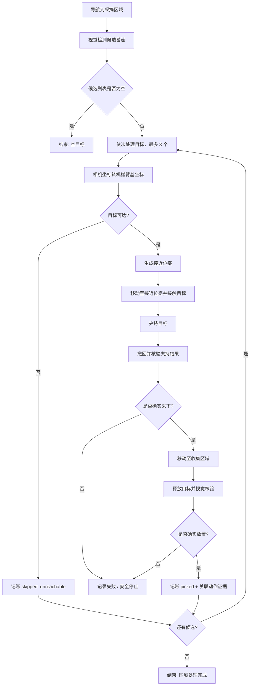

# 番茄采摘示例的流程与配置

本目录提供基于 MockWorld 的采摘开发示例，使用模拟观测、夹持状态与固定 X 平移，不连接真实 ROS 子系统或硬件；运行命令见 [README](README.md)

## 配置选择

完整采摘任务使用 system.yaml 中的单个 robot 后端；任务说明和标定资产也绑定 robot，改用四后端配置会触发资产身份校验

system_four_backends.yaml 用于参考角色分离方式，各后端有独立运行模块，同一执行器中的模拟适配器共享目标和夹持状态

| 子系统 | 后端实例 | 主要能力 | 模拟执行者 |
| --- | --- | --- | --- |
| 导航 | `navigation` | 到达作业区 | `tomato_simulator.navigation` |
| 视觉 | `vision` | 检测候选番茄、核验采摘与放置 | `tomato_simulator.vision` |
| 机械臂 | `arm` | 坐标变换、可达性、接近、转运 | `tomato_simulator.arm` |
| 电控/末端 | `control` | 夹持、释放、作业记录 | `tomato_simulator.control` |

## 采摘流程

执行拓扑保存在 tasks/harvest.xml 中，图示用于阅读流程

## 运行结果

| 情况 | 处理结果 |
| --- | --- |
| 可达目标完成夹持、采摘核验、释放和放置核验 | 记为 picked，关联已完成操作的证据 |
| 目标不可达 | 记为 skipped，不派发该目标的夹爪动作 |
| 候选列表为空 | 记录空目标结果，无夹取动作 |
| 放置核验失败或取消 | 保留错误原因与停止状态 |

当前最多处理 8 个候选，max_recovery_attempts 为 0，不自动重试动作；运行时先等待系统 READY，再提交任务，取消后检查停止确认信息

## 文件与用途

| 文件 | 用途 |
| --- | --- |
| `package.yaml` | 模拟接入包及 12 项能力 |
| `system.yaml` | 单后端采摘配置与角色绑定 |
| `system_four_backends.yaml` | 四后端角色分离参考配置 |
| `assets/camera_to_arm.json` | 固定 X 平移的模拟变换资产 |
| `tasks/harvest.xml` | 包含 Harvest / PickFruit 子树的执行树 |
| `tasks/harvest.task.json` | 参数、资产、候选上限、恢复次数和超时限制 |
| `tasks/harvest.layout.json` | 独立布局占位数据，动作顺序由执行树定义 |
